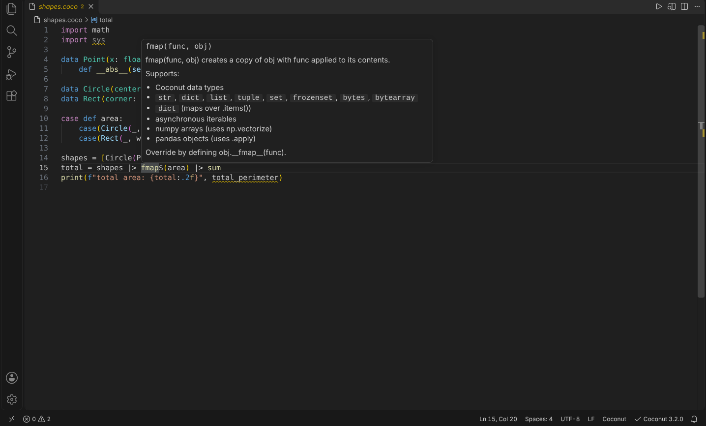
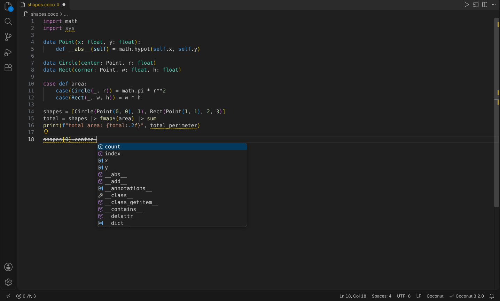
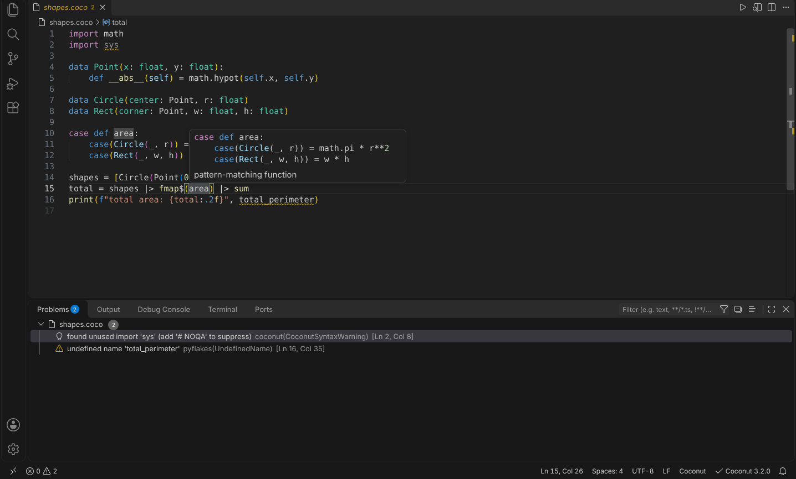
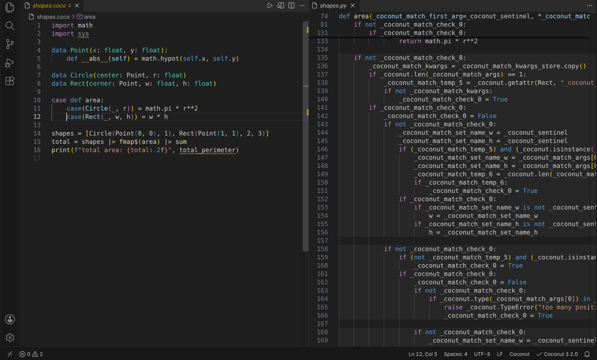

# Coconut Editor Support: VS Code, Sublime Text, and AI Agents

This repository contains [Coconut](https://github.com/evhub/coconut) language support for [Visual Studio Code](https://marketplace.visualstudio.com/items?itemName=evhub.coconut) (and compatible editors like VSCodium and Cursor, via [Open VSX](https://open-vsx.org/extension/evhub/coconut)), [Sublime Text](https://packagecontrol.io/packages/Coconut), and AI coding agents (via [MCP](#ai-agents)):

- **Syntax highlighting** and snippets for `.coco` files (and Coconut code blocks in Markdown).
- **A Coconut language server**, providing:
  - errors and warnings from the Coconut compiler as you type, with precise locations;
  - linting of the compiled code (undefined names, unused imports and variables, redefinitions), mapped back to your Coconut source;
  - optional type checking with [mypy](https://mypy-lang.org), also mapped back to your Coconut source;
  - hover information: types, signatures, and docstrings, plus Coconut's own documentation for built-ins (`fmap`, `reduce`, ...), keywords (`match`, `data`, `where`, ...), and operators (`|>`, `..>`, `$`, `??`, ...);
  - completions (including while the file doesn't compile yet) and signature help;
  - go to definition (including across `.coco` files), go to type definition, find references, highlight references, and rename;
  - document outline and workspace symbol search;
  - quick fixes to remove unused imports or suppress a warning with `# NOQA`.
- **Commands** (VS Code) to show the compiled Python side by side, run or compile the current file, and open the Coconut interpreter.

| Hover docs for Coconut built-ins, live errors and lint | Completions, even while the line doesn't compile |
| --- | --- |
|  |  |
| **Pattern-matching functions and the Problems panel** | **Compiled Python, side by side and in sync** |
|  |  |

For installation instructions for Coconut itself, see [Coconut's documentation](https://coconut.readthedocs.io/en/master/DOCS.html#installation).

## VS Code

Install the [Coconut extension](https://marketplace.visualstudio.com/items?itemName=evhub.coconut), then make sure the Python interpreter you use has Coconut installed:

```bash
pip install coconut
```

The language server runs with the interpreter selected in the [Python extension](https://marketplace.visualstudio.com/items?itemName=ms-python.python) (or `python3`/`python` if it isn't installed); if Coconut isn't installed there, the extension offers to install it. To use a different interpreter, set `coconut.languageServer.pythonPath`. Code intelligence ([jedi](https://github.com/davidhalter/jedi)) and linting ([pyflakes](https://github.com/PyCQA/pyflakes)) come bundled; versions installed in your environment take precedence.

**Commands** (Command Palette → "Coconut"):

| Command | |
| --- | --- |
| Coconut: Show Compiled Python (`Ctrl+K V`) | Opens the compiled Python beside the editor, scrolled to the current line, updating live as you type |
| Coconut: Run Coconut File | Runs the file in a terminal (`coconut --run --no-write`) |
| Coconut: Compile Coconut File | Compiles the file to a `.py` next to it |
| Coconut: Open Coconut Interpreter | Starts the Coconut REPL in a terminal |
| Coconut: Install/Upgrade Coconut in the Selected Interpreter | |
| Coconut: Restart Language Server | |

**Settings:**

| Setting | Default | |
| --- | --- | --- |
| `coconut.target` | `"sys"` | Python version to target (Coconut's `--target`), e.g. `"3.8"`, `"2.7"` |
| `coconut.strict` | `false` | Coconut's `--strict` style checks |
| `coconut.languageServer.enabled` | `true` | Start the language server |
| `coconut.languageServer.server` | `"auto"` | `"auto"`: Coconut's own `coconut --lsp` if the installed Coconut has it, else the bundled server; or `"coconut"` / `"bundled"` (see [below](#which-language-server-runs)) |
| `coconut.languageServer.pythonPath` | `""` | Interpreter with Coconut installed (default: the Python extension's selection) |
| `coconut.languageServer.lint` | `true` | Lint compiled code with pyflakes |
| `coconut.languageServer.mypy` | `false` | Type-check with mypy on open/save (needs `pip install mypy`) |
| `coconut.languageServer.compileTimeout` | `60` | Seconds before giving up on compiling a file |
| `coconut.languageServer.command` | `[]` | Advanced: a custom command to start a language server |

## Sublime Text

Install the [Coconut package](https://packagecontrol.io/packages/Coconut) for syntax highlighting and build systems ("Run file", "Check file for errors", ...). For the language server, also install the [LSP package](https://packagecontrol.io/packages/LSP) and Coconut, plus optionally jedi and pyflakes for code intelligence and linting:

```bash
pip install coconut jedi pyflakes
```

The Coconut language server then starts automatically for Coconut files, using `python3` (`python` on Windows). To use a specific interpreter, open Preferences → Package Settings → Coconut → LSP Settings and set:

```json
{
    "command": ["/path/to/venv/bin/python", "${server_path}"]
}
```

## AI agents

The language server, a [Model Context Protocol](https://modelcontextprotocol.io) server, and a command-line interface all make Coconut tooling available to AI coding agents. They need Python 3 with Coconut installed (`pip install coconut jedi pyflakes`).

### Claude Code

The Claude Code plugin for Coconut lives in the [Coconut repository](https://github.com/evhub/coconut), versioned with the compiler. It runs Coconut's own language server (`coconut --lsp`) and MCP server (`coconut --mcp`), and includes a skill built on `coconut --ai-docs`. It needs `coconut-develop` 3.2.0.post0.dev20 or later (`pip install -U "coconut-develop[lsp]"`):

```
/plugin marketplace add evhub/coconut
/plugin install coconut@coconut
```

### Other agents (MCP)

Any MCP-capable agent (Cursor, Codex, VS Code Copilot, Claude Desktop, ...) can use the Coconut MCP server. With `coconut-develop` 3.2.0.post0.dev20 or later, use `"command": "coconut", "args": ["--mcp"]`. With a released Coconut, clone this repository and add a stdio server to your agent's MCP configuration:

```json
{
    "mcpServers": {
        "coconut": {
            "command": "python3",
            "args": ["/path/to/sublime-coconut/server/coconut_language_server.py", "mcp"]
        }
    }
}
```

Tools: `coconut_check` (errors and warnings for a file, directory, or snippet, optionally type-checked with mypy), `coconut_compile` (the Python a snippet compiles to), `coconut_docs` (Coconut documentation for any built-in, keyword, or operator), `coconut_hover`, `coconut_definition`, `coconut_references`, and `coconut_symbols`.

### Command line

The same features are available as one-shot commands, for scripts, CI, and agents without MCP support. Positions are 1-based; add `--json` for machine-readable output.

```bash
python3 server/coconut_language_server.py check src/              # exit code 1 if there are errors
python3 server/coconut_language_server.py check src/ --mypy       # also type-check with mypy
python3 server/coconut_language_server.py compile file.coco --no-line-comments
python3 server/coconut_language_server.py hover file.coco 12 5
python3 server/coconut_language_server.py definition file.coco 12 5
python3 server/coconut_language_server.py references file.coco 12 5
python3 server/coconut_language_server.py symbols file.coco
python3 server/coconut_language_server.py docs "|>"
```

### Other editors

Any editor with LSP support (Neovim, Helix, Emacs, Zed, ...) can use the language server: run `python3 /path/to/sublime-coconut/server/coconut_language_server.py` (LSP over stdio) for files with the `coconut` language ID. Initialization options (also accepted through `workspace/didChangeConfiguration`): `target`, `strict`, `lint`, `mypy`, `compileTimeout`. The server also answers `coconut/compiled` (`{textDocument: {uri}}` → the compiled Python) and `coconut/info` requests.

## Which language server runs

Coconut's development version includes its own language server, `coconut --lsp`: from `coconut-develop` 3.2.0.post0.dev20 on, it's this repository's language server, merged into Coconut and versioned with the compiler (install it with `pip install -U "coconut-develop[lsp]"`; it runs on Python 3.8+). The editor packages and the launcher (`server/coconut_language_server.py`) use it automatically whenever the installed Coconut has it, and otherwise fall back to the language server bundled here, so released versions of Coconut get full support too. Earlier development versions had a more limited `coconut --lsp`, so the bundled server is preferred over those. To choose explicitly, set `coconut.languageServer.server` in VS Code to `"coconut"` or `"bundled"`, or pass `--server coconut|bundled` to the launcher.

## How the bundled language server works

The server (in [`server/`](server), pure Python with no dependencies besides Coconut) compiles each open file with the Coconut compiler in a background worker process, reporting the compiler's errors and warnings. For code intelligence, it runs jedi on the compiled Python and maps positions back to the Coconut source using the line-number comments the compiler emits. When the file doesn't compile (as while typing), it analyzes the most recent version that did, with the code being typed spliced in at the matching scope, and neutralizes broken lines so the rest of the file stays analyzable.

## Development

```bash
make test           # language server tests (pip install -r server/requirements.txt pytest)
make test-vscode    # VS Code integration tests (needs Node.js; uses xvfb-run on Linux)
make package        # build the .vsix (bundles jedi/pyflakes via scripts/vendor.py)
make docs-data      # regenerate hover docs from Coconut's DOCS.md
```

Syntax highlighting is generated from [`sublime_coconut/specification.py`](sublime_coconut/specification.py) with `python build.py` (requires [tmtools](https://github.com/evhub/tmtools)). See [AGENTS.md](AGENTS.md) for a guide to the codebase.

Credits:
- VSCode integration based on [kobarity](https://github.com/kobarity)'s [Coconut VSCode package](https://github.com/kobarity/vsce-coconut).
- Python syntax highlighting based on [petervaro](https://github.com/petervaro)'s [Python highlighter](https://github.com/petervaro/python).
